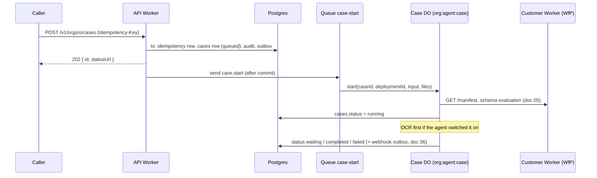

# 04. Case API and the 202 flow (build step 3)

Scope: build step 3. A case starts from an API call, a schedule, the app's Add button, or MCP. The API call returns 202 Accepted with the case id and a status URL and honors `Idempotency-Key`. There is no inbound email address and no separate inbound webhook URL. Schema engine in [05](05-schema-engine.md), webhooks in [06](06-groups-notifications-webhooks.md).

## Decision

- **One create operation** for every start: `POST /v1/orgs/{org}/cases`. The app's Add button and the MCP tool (generated from the same OpenAPI operation) call it; schedules call the same internal function. There is no inbound email address and no second inbound webhook URL.
- **Returns 202 Accepted** once the case row is committed and the start is enqueued. The body has the case id and status URL; `Location` is the status URL.
- **`Idempotency-Key`** is honoured per organization for 24 hours, with the request fingerprint stored so a reused key with a different body is rejected.
- Routes carry the organization in the path for every caller. A session must be a member; an API key must belong to that organization, otherwise 404.

## API

```ts
// POST /v1/orgs/{org}/cases
// Headers: Authorization (session or API key), Idempotency-Key?: string (1–255 chars)
// A case's input is files, plain text, or both; there is no input schema
const CreateCase = z.object({
  agent: z.string(),                                  // agent slug or id
  deployment: z.string().optional(),                  // a preview deployment id; default: the production deployment
  text: z.string().max(1_000_000).optional(),         // plain text input
  files: z.array(z.string()).max(100).default([]),    // file ids from POST /v1/orgs/{org}/files
}).refine((b) => (b.text?.length ?? 0) > 0 || b.files.length > 0, { message: "text, files, or both are required" });

// 202 Accepted
// Location: /v1/orgs/{org}/cases/{id}
const CaseAccepted = z.object({
  id: z.string(),                                     // case_…
  status: z.literal("queued"),
  statusUrl: z.string().url(),
  createdAt: z.string().datetime(),
});
// Replay of the same key and body: 202 with the original body and header Idempotent-Replayed: true

// GET /v1/orgs/{org}/cases/{id}  — the status URL
const Case = z.object({
  id: z.string(),
  agent: z.object({ id: z.string(), slug: z.string() }),
  deployment: z.object({ id: z.string(), environment: z.enum(["production", "preview"]) }),
  status: z.enum(["queued", "running", "waiting", "halted", "completed", "failed", "cancelled"]),
  haltReason: z.enum(["credit_exhausted", "spending_limit_reached"]).nullable(),
  waitingOn: z.object({ id: z.string(), slug: z.string(), name: z.string() }).nullable(),
  assignees: z.array(z.object({ id: z.string() })),  // user ids; names are resolved by the app
  source: z.enum(["api", "app", "mcp", "schedule"]),
  title: z.string().nullable(),
  answers: z.record(z.unknown()).nullable(),          // nested current answers once completed (doc 05)
  error: z.object({ code: z.string(), message: z.string() }).nullable(),
  costUsd: z.number(),
  createdAt: z.string(), updatedAt: z.string(), completedAt: z.string().nullable(),
  url: z.string().url(),                              // the case room
});
```

Files are uploaded first (`POST /v1/orgs/{org}/files`, multipart, returns `{ id }`, stored in R2 under the organization) and referenced by id. This keeps the create call JSON and retryable.

Errors use one shape (`{ error: { code, message, details? } }`):

| Status | Code | When |
|---|---|---|
| 400 | `invalid_request` | Body fails Zod |
| 404 | `not_found` | Organization, agent, deployment or file not visible to the credential |
| 409 | `no_production_deployment` | Agent has never been promoted and no `deployment` was given |
| 409 | `idempotency_in_progress` | Same key is being processed by a concurrent request |
| 422 | `idempotency_mismatch` | Same key, different fingerprint |
| 429 | `rate_limited` | Per-organization rate limit, with `Retry-After` |
| 402 | `spending_limit_reached` | The organization has reached the spending limit an Admin set. Cloud and self-hosted |
| 402 | `credit_exhausted` | Our cloud only: the organization's Autumn credit has run out. Never returned by self-hosted installs |

## Idempotency

```ts
export const idempotencyKeys = pgTable("idempotency_keys", {
  organizationId: text().notNull(),
  key: text().notNull(),
  operation: text().notNull(),                        // "cases.create"
  fingerprint: bytea().notNull(),                     // SHA-256 of JCS(body) + credential id
  caseId: text(),
  responseBody: jsonb(),
  createdAt: timestamp({ withTimezone: true }).notNull().defaultNow(),
  expiresAt: timestamp({ withTimezone: true }).notNull(),
}, (t) => [primaryKey({ columns: [t.organizationId, t.operation, t.key] })]);
```

Keys live for 24 hours. In one transaction: `INSERT … ON CONFLICT DO NOTHING` on the key; if it inserted, create the case, write the response, audit `case.created`, write the outbox row; if it conflicted, read the stored row and replay (same fingerprint), 422 (different) or 409 (no response yet). A daily job deletes expired rows. Only `cases.create` uses it in step 3; the table is generic because other POSTs (files) may adopt the header later.

## Start flow



- The DO `start` is idempotent on the case id, so a duplicate Queue delivery is harmless.
- **Backstop:** if the post-commit Queue send fails, a cron every minute re-enqueues cases that have been `queued` with an undrained outbox row for more than a minute.
- OCR before the run happens inside the DO before the first model call, through the OCR API; the case stays `running`.
- **Two separate stops on spend.** Both are checked at case creation and before each metered model, OCR or `decide` call, through one function, `spendGate(org)`, which returns `ok`, `spending_limit_reached` or `credit_exhausted`:
  - **Spending limit** (a guardrail, cloud and self-hosted). Optional, none by default; an Admin may set one. It covers a calendar month in UTC. Spend is only metered use of our hosted service: calls a self-hosted install sends to its own serving URLs never count, so an install using only its own URLs never reaches the limit. The month's spend is the organization's metered cost rolled up from doc 01's `costMicroUsd`. Code cannot raise it; lowering it is a tightening and needs no approval.
  - **Credit** (our cloud only). Autumn watches spend against the organization's credit; `getPlan(org)` reports whether credit remains. Self-hosted installs have no credit and never stop for it.
  - Either stop refuses new cases with 402 (every source, schedules included; a refused schedule fire is recorded on the schedule, not retried) and halts running cases at their next metered call instead of starting it.
  - **Halted cases** get status `halted` with `haltReason`, shown in the inbox to Owners and Admins. They do not restart on their own when credit is added or the limit raised; an operator restarts each with Rerun, which runs the gate again first. A halt fires no webhook.

```ts
// The guardrail's value. Stored with the other organization guardrails, whose full design is step 5;
// step 3 needs only this shape to enforce it.
type SpendingLimit = { amountMicroUsd: number } | null;   // per calendar month, UTC; null = no limit (the default)
```
- Status transitions are written to the case index by the DO through the API's internal binding (one writer of `cases`), which also emits webhook events (doc 06).

## Schedules

Declared in agent code; listed and paused through the API, never created there.

```ts
// SDK
schedules: [{ name: "nightly-reconcile", cron: "0 2 * * *", timezone: "America/New_York", text: "Reconcile all open invoices", previews: false }]

// API
GET  /v1/orgs/{org}/agents/{agent}/schedules            → [{ name, cron, timezone, paused, nextRunAt, lastCaseId }]
POST /v1/orgs/{org}/agents/{agent}/schedules/{name}/pause
POST /v1/orgs/{org}/agents/{agent}/schedules/{name}/resume
```

- One scheduler Durable Object per organization and agent (`org:agent:scheduler`) holds the production deployment's schedules and sets an alarm for the next fire time. Cron Triggers are not used: they are per script, are fixed at upload, and dispatch-namespace scripts are not the place for platform timing.
- On promotion the scheduler is replaced with the new deployment's schedules.
- **Previews** do not run schedules unless configured to: a schedule's `previews: true` in code runs it for preview deployments too, each preview with its own scheduler object (`org:agent:scheduler:<deploymentId>`). As a schedule setting it is a default, so the dashboard can override it from step 5.
- **Pause survives deploys** until someone unpauses it. Pause state is kept by schedule name in the agent's scheduler object, separate from the deployment's schedule list, so a promotion keeps it. If a new deployment drops the schedule name, the pause record is dropped with it. Pause and unpause are audit events.
- A fire calls the internal create with `source: "schedule"`, `createdBy: schedule name` and the idempotency key `schedule:{name}:{fireTimeISO}`, so a retried alarm never creates a second case.
- A fire missed while the DO was unavailable runs once on recovery, not once per missed interval.

## Assignment

```
PUT /v1/orgs/{org}/cases/{id}/assignees   { userIds: string[] }   → 200 { assignees: [{ id }] }
```

- Allowed for API keys and, in the app, for Owners and Admins. Agent code never assigns, and there is no claim.
- Every user must be able to see the case (doc 01 `canSeeCase`); otherwise 422 `assignee_without_access`.
- Replaces the whole set; each change is an audit event. Assigned cases appear in the assignee's inbox (doc 06).

## Other starts

- **App (Add button):** session credential, `source: "app"`. Needs operator access on the agent or membership in Developers.
- **Files and OCR:** if the agent switched on OCR before the run, each uploaded file goes through the OCR client of doc 07 before the first model call. In steps 1–6 that client talks to the stub model service.
- **MCP:** the MCP server (step 8) calls the same operation and sends `X-Preprocess-Client: mcp`, recorded as `source: "mcp"`. The source is informational and grants nothing.
- **API key:** `source: "api"`.

## Who may create

Operators of the agent and the Developers group (session), and any API key of the organization (keys are organization-wide). Owners and Admins who are in neither only view and assign, so starting a case needs an operator group like any other work on it.

## Alternatives rejected

- **`POST /v1/cases` with the organization taken only from the key.** Nicer for one-org integrations, but sessions span organizations, and two shapes for one operation doubles the OpenAPI surface. The path is explicit and the key is still checked.
- **Synchronous create (201 after the agent starts).** The DO cold start plus manifest read is hundreds of milliseconds, and the API contract is 202.
- **Calling the DO directly from the request instead of a Queue.** Faster by one hop, but a failure after commit leaves a queued case with nothing to retry it besides the sweeper; the Queue gives retries for free. The sweeper stays as the second line.
- **Workflows for case start.** The DO is already the durable owner of the case; a Workflow would be a second one.
- **Cron Triggers for schedules.** Explained above.

## Settled decisions

- Case input is files, plain text, or both; no input schema.
- Schedules don't run on previews unless configured to; a pause survives deploys until unpaused.
- On our cloud, Autumn's credit stop refuses new cases and halts running ones.
- The spending-limits guardrail stays: optional, no limit by default, set by an Admin, on our cloud and self-hosted. It is a separate stop from credit.
- Cases can be assigned through the API or by an Admin; never by agent code.
- Halted cases: status `halted` with a reason, restarted only by Rerun. The spending limit covers a calendar month in UTC and counts only metered use of our hosted service.
- A halted case does not fire `case.failed`; callers see it on the status URL.
- Also settled: a 24-hour idempotency window; MCP starts identified by a client header; cancellation sends no webhook.


## Open questions

None left in this doc.

