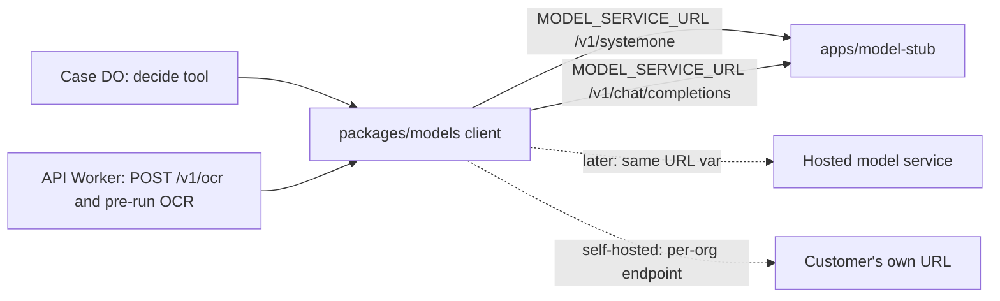

# 07. Stub model service for `decide` and OCR (build step 3)

Scope: build step 3. `decide` runs on the Groundhog-1 decision model and OCR on LightOn OCR 3 4B, both served by our hosted model service, or by a self-hosted install's own serving URLs. Until the hosted service exists, steps 1–6 run against a stub that speaks the same contracts. `/v1/systemone` is the contract between the platform and the decision model, and self-hosters' URLs must implement it.

## Decision

- The GPU side is deferred, so there are no hosted models for steps 1–6. Step 3's `decide` and OCR call a **stub model service** that speaks exactly the real contracts:
  - `POST /v1/systemone`: Baseten's System One API, which vLLM also implements, for Groundhog-1.
  - `POST /v1/chat/completions`: the OpenAI-compatible shape vLLM serves for LightOn OCR 3 4B.
- **The stub is selected by URL, never by a code switch.** The platform's model client is the same code whether it talks to the stub, our hosted model service or a self-hoster's own URL. This keeps the run-mode rule that switches never select a different implementation.
- The stub lives in preprocess/preprocess as **`apps/model-stub`**, a small Hono Worker. Alchemy declares it in the local, `pr-<n>` and staging stages, never in a production stage. Its responses are deterministic and seedable, so seeded scenarios and tests get the same answers every time.

## Where it is used



Only the API Worker and the runtime Worker call models. Customer code never does: `decide` is a runtime tool (doc 05), and OCR runs on the platform side before the case runs or behind `POST /v1/ocr`.

## Selection by configuration

```ts
// infra/src/workers.ts (Alchemy): bound on the API and runtime Workers
MODEL_SERVICE_URL: string            // local: http://model-stub.preprocess.localhost, pr-<n>: the stage's stub Worker URL,
                                     // staging: the staging stub until a staging model service exists
MODEL_SERVICE_KEY: Secret            // the stub accepts any non-empty bearer token; real services check it

// packages/models/src/endpoints.ts: the one resolver
type ModelPurpose = "decide" | "ocr";
function modelEndpoint(env: Env, org: OrgId, purpose: ModelPurpose): Promise<{ url: string; key: string; model: string }>;
// 1. If the organization registered its own endpoint for this model, use it.
// 2. Otherwise use MODEL_SERVICE_URL and MODEL_SERVICE_KEY, with model "groundhog-1" or "lightonai/LightOnOCR-3-4B".
```

- In local and preview stages the service binding is replaced by a plain URL so that the code path is identical to production, where the service is outside Cloudflare.
- An install with no `MODEL_SERVICE_URL` and no registered endpoint returns `503 model_unavailable` from `decide` and OCR. It never falls back to the stub on its own.
- Every call is metered from step 2. Usage on the stub is recorded with `model: "stub"` and zero cost, so metering is exercised without charging anyone and spending limits (doc 04) never trip on stub traffic.

## `/v1/systemone` (decide)

The request and response follow Baseten's System One reference (docs.baseten.co/reference/inference-api/system-one, read 2026-11-24). We send only the subset `decide` needs.

```ts
type SystemOneRequest = {
  model: string;                                         // "groundhog-1"
  state: string | Record<string, unknown> | unknown[] | { messages: Array<{ role: "user" | "assistant"; content: unknown }> };
  questions: Record<string, (
    | { type: "choice"; instructions?: string; criteria: Record<string, string | null> }   // 1–255 options
    | { type: "noul"; instructions?: string; criteria?: { true: string; false: string } }
    | { type: "score"; instructions?: string; criteria: string[] }                         // 1–10 levels
  )>;                                                     // at most 512 options per request; noul counts as 2
  max_len?: number;
};

type SystemOneResponse = {
  model: string;
  answers: Record<string,
    | { type: "choice"; choice: string; probabilities: Record<string, number> }
    | { type: "noul"; noul: number }                     // probability of yes
    | { type: "score"; score: number; legend: Record<string, unknown>; probabilities: Record<string, number> }>;
  // choice and score answers also carry `confidence` (0 uniform, 1 certain), and usage carries output_tokens,
  // as in Baseten's reference; packages/models/src/contract.ts is the authoritative schema.
  usage: { input_tokens: number };
};
```

How `decide({ path, prompt, keep? })` maps onto it:

- `state` is an object with the prompt and the case context the runtime passes: `{ prompt, case: { input text, relevant answers } }`.
- One `choice` question, `pick`, with `criteria` mapping each option id to its label and description.
- `keep = 1` returns the top option; `keep = n` returns the `n` most probable, with probabilities.
- **Lists over 255 options** run as rounds: split into chunks of at most 255 (or fewer, so each request stays within 512 options), keep the best `max(keep, 8)` of each chunk, then decide among the survivors. All chunks go in parallel, one request each.
- The option list comes from the field's source in the customer's Worker (doc 05, `/schema/options` paging), fetched by the runtime, and never enters the agent's context.

## OCR

The platform side is `POST /v1/ocr` and the pre-run OCR option. Both render each page and call the model service in the OpenAI chat-completions shape that vLLM serves for LightOn OCR 3 4B:

```ts
// platform → model service
type OcrModelRequest = {
  model: "lightonai/LightOnOCR-3-4B";
  messages: [{ role: "user"; content: [{ type: "image_url"; image_url: { url: string } }, { type: "text"; text: "" | "grounding" }] }];
  // one page per request: PNG data URL, longest edge 2048 px
};
// response: standard chat.completion; choices[0].message.content is the page as Markdown
// ("" mode) or Markdown with labelled blocks and bounding boxes ("grounding" mode)

// platform → caller (POST /v1/orgs/{org}/ocr)
type OcrResult = {
  pages: Array<{ index: number; markdown: string; blocks?: Array<{ label: string; bbox: [number, number, number, number]; text: string }> }>;
  model: string;
};
```

Rendering PDFs to page images happens on the platform side. Nothing in the stub depends on that.

## What the stub returns

The stub validates requests as strictly as the real service, so code cannot come to depend on a looser stub. That means the System One limits (255 options per choice, 512 per request, at most 16 images, no number, boolean or null state), the same 400 and 422 codes, and a bearer token on every call.

**`/v1/systemone`.** Answers are deterministic for a given request:

1. **Fixtures first.** `apps/model-stub/fixtures/systemone/*.json` maps a question's name and a substring of the state to a fixed answer. Seeded scenarios use these, for example "invoice from Acme → vendor `acme`, p = 0.93".
2. **Otherwise a lexical score.** For `choice`, each option scores the overlap between its id, label and description and the words of the state and instructions, plus a small tie-breaker from a hash of `(state, question, option)`. Probabilities are a softmax over the scores. `noul` is 0.5 moved toward 0 or 1 by overlap with the `true` and `false` descriptions. `score` puts its mass on the level with the most overlap.
3. `model` is `"stub-groundhog"`, and `usage.input_tokens` is roughly the character count divided by 4.

**`/v1/chat/completions` for OCR.**

1. **Fixtures by image hash.** `fixtures/ocr/<sha256>.json` holds the Markdown and, optionally, the blocks for a sample document in the seed data; the sample images live in `fixtures/ocr/samples/`.
2. **Otherwise a placeholder:** `# Stub OCR\n\nPage text is not available without the OCR model (image <sha256 prefix>).`, and one `text` block covering the page in grounding mode.

**Controls for tests and seeded failure states**, available only in the stub:

- Request header `x-stub-latency-ms` (or the `STUB_LATENCY_MS` variable) adds delay.
- Request header `x-stub-fail: 429 | 500 | 503 | timeout` simulates errors.

The platform client never sends these headers in normal code. Tests set them through the test harness.

The stub has no state, no database and no GPU, and it is only deployed to local, preview and staging stages. It ships with the public repository because PR previews and self-hosters' development setups need it.

## Alternatives rejected

- **Workers AI or another hosted model as a stand-in.** Not one of the supported models, it costs money in every preview, and it would make seeded scenarios non-deterministic. the runtime spike used Workers AI only for a throwaway spike.
- **A `STUB_MODELS=true` flag in platform code.** That is a switch selecting a different implementation, which run mode rules out, and the HTTP client would go untested.
- **Mocking inside the runtime** (an in-process fake `decide`). Same problem: it skips the client, auth, metering and error paths that production uses.
- **Baseten's hosted Groundhog-1 for staging.** It works today, but it is a third-party model host outside our supported stack. It remains the calibration reference the model-serving research will compare our serving against, not a dependency.

## Open questions

None. To verify:

- The exact grounding output format of LightOn OCR 3 4B (how blocks and boxes appear in the content) is taken from the model-serving research's reading of the model card and has not been run. The OCR client's parser (`parseGrounding` in `packages/models/src/ocr.ts`) and the stub's fixtures should be checked against a real response once a GPU is available.
